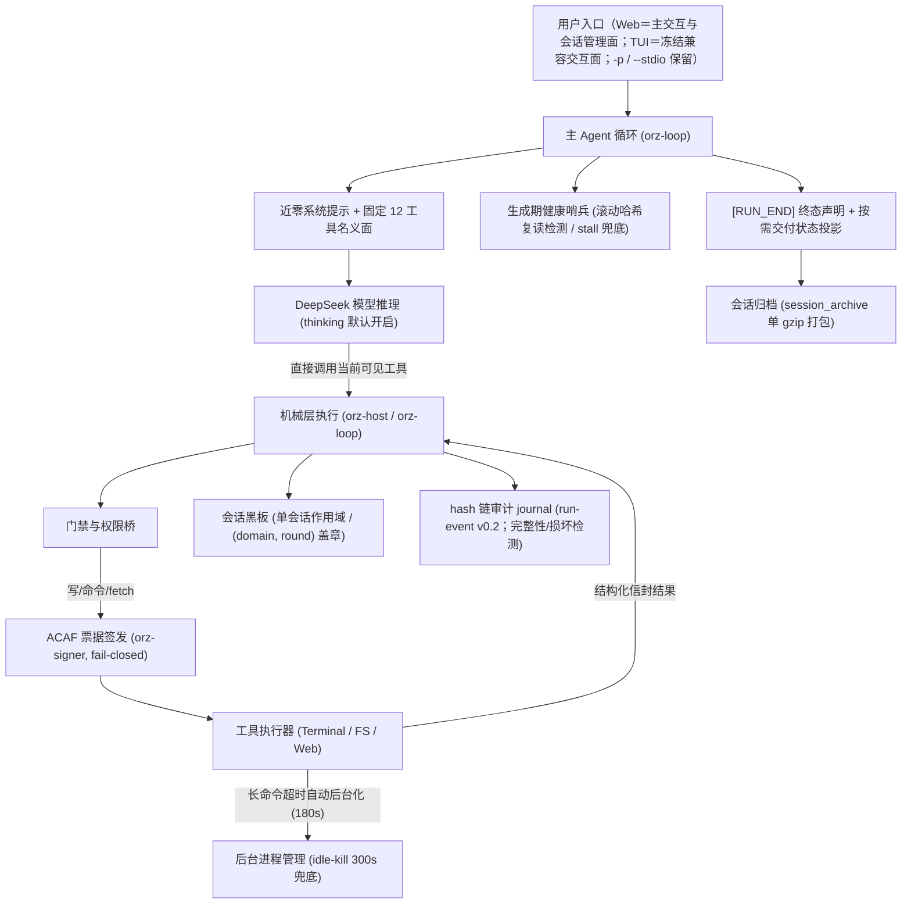

# 当前生产架构投影（Current Architecture Projection）

> **状态**：`current-design`（投影文件，不独立产生新设计）；**更新日期**：2026-10-25
> **设计权威**：[`adr/ADR-0010-fusion-runtime-and-agent-architecture.md`](../../adr/ADR-0010-fusion-runtime-and-agent-architecture.md)（含 §14.52 会话黑板、§14.54 压缩快照、§14.55 工具执行层改革、§14.65 检索双车道、§14.69 上下文滑块 v8、§14.72 压缩交互第九工具、§14.76 反例门触发条件收窄——answer 变体仅在有执行事实或未完成 plan 时触发）
> **治理边界**：本文件为 ADR-0010 与当前真实代码运行链路的直映投影，不独立产生新设计。

---

## 1. 真实产品面运行拓扑

系统当前实际运行的主链路为**“单主 Agent 推动 + 固定 12 工具名义面（检索默认开启时主面可见 11）直接执行 + 机械会话黑板 + 离线审计哈希链”**。工具数按生产装配计，不把已退役但仍为兼容测试保留的 `submit` 算入现行模型面。

---

## 2. 核心架构要素与真实边界

### 2.1 Agent 层：固定 12 工具名义面
- **主 Agent**：唯一任务推进者。系统提示近零；生产装配的 12 工具名义面为 8 个保留工具
  `read_file`, `grep`, `search_replace`, `run_terminal_cmd`, `web_search`, `web_fetch`, `get_task_output`, `kill_task`，
  加 `blackboard_read`, `blackboard_write`（计划/笔记/发现写入，单条 ≤8K）、
  `context_manage`（`compress`／`clear`／`all+clear`）和 `self_check`。
  `context_compress` 已由 `context_manage mode=compress` 取代；`submit` 已从模型工具面退役，仅在兼容开关下保留旧路径。
- **可见数与检索门**：联网检索默认开启；此时 `web_fetch` 按单入口投影退出主面，模型可见 11 个工具；显式设置 `ORZ_RETRIEVAL_ENABLED=0` 时检索族关闭，主面可见 12 个工具。计数以 `orz-loop/src/controller.rs` 的生产装配为准。
- **外部检索子代理**：检索启用会话为子代理注册本地浏览器与原生 web 双族工具（静态标注，本地浏览器优先，换道由模型自主）；`--retrieval-enabled` 仅保留为兼容的显式开启旗。
- **执行方式**：**直接调用（direct execution）**。早期设计的 `console` 动作栏下单及 `plan-first` 硬门在生产路径中处于休眠/退役状态。
- **轮预算**：默认无限制（`MAX_TOOL_ROUNDS = 0`，撤除默认 120 轮硬限，保留可配逃生阀）。
- **终态与自查**：有本 run 执行事实时，纯文本终答以 `[RUN_END]` 声明收束；缺失声明时机械层最多提示两次后 fail-open。反例自查由模型主动调用 `self_check`（PULL），不再在 required 路径自动注入。

### 2.2 机械层与安全：ACAF 票据与去硬杀
- **去自身硬超时**：不再以 timeout 硬杀活跃进程；前台命令超过预算（默认 180s）自动后台化，由 300s 无输出/无 CPU 活跃的 `idle-kill` 机制接管兜底，外加 10h 绝对兜底。
- **安全授权**：`orz-signer` 独立进程签发一次性票据。本地文件写入、终端命令执行和网络 fetch 必须过票据门（fail-closed）。

### 2.3 上下文与黑板：会话作用域、折叠渲染与模型参与压缩
- **黑板作用域**：单会话作用域（conversation-scoped）。放弃历史的 plan-epoch 轮换设计，黑板跨轮保留全量记录。
- **折叠渲染**：写入时按 `(domain, round)` 盖章；`blackboard_read` 按域与轮数按需做折叠渲染（render fold），响应头携带黑板水位与「滑块外可压缩 N 块」读数。
- **模型写入面**：`blackboard_write`（plan/notes 区，单条 ≤8K；0ae D0 起在面）。
- **上下文＝模型自控注意力窗口**（ADR §14.69）：模型面＝主滑块＋主滑块以外分块指针（分块内容不流出模型面）；机械轨按阶梯收窄模型面（软提醒 → 320K 硬打断 → 500K 必定压缩，两轮仍无摘要才机械截断），语义轨经压缩窗口由模型产出结构化摘要；模型通过 `context_manage` 的 `compress`／`clear`／`all+clear` 模式知情管理。压缩不覆盖本地面，全量留档、按块回放。
- **会话归档**：交互会话结束时由 `session_archive` 单包原子写入 gzip 归档文件；无头 `-p` run 落会话持久化并按里程碑增量归档（0ak）。

### 2.4 审计与完整性：Hash-Chained Journal
- 每次运行写入事件 journal（schema v0.2），每条记录计算单向哈希链（SHA-256）。
- 离线可通过 `--replay` 交叉校验完整性与检测损坏。**口径＝完整性/损坏检测**：链断／篡改**可被检出**，但 hash 链不提供外部锚定的「防篡改保证」（receipt 链／外部 digest 锚不立项——083 审查裁决③、0bv D-6，2026-09-27）。

### 2.5 会话所有权与交互面（2026-10-21 331 批）

- **交互面定位**：Web 工作台是继续演进的主交互与会话管理面。TUI 二进制与交互运行路径仍在役，但产品状态为 `frozen`：保留现有运行、审批、只读回看和快捷键能力，仅修崩溃/安全，不再新增会话管理能力，也不支持跨进程恢复。因此“冻结”不等于“入口已删除”。`-p` 无头与 `--stdio` ACP 继续作为无头/集成入口。
- **会话 owner 唯一**：持 `.gsa/sessions/<s8>.lease` 的 agent 进程；`orz-web` 桥只做传输（WS↔child），不持会话真相。
- **关闭语义**：私有扩展 `_orz/session_close`——先 cancel 在途 run（10s 上限）再释放 lease，幂等；不追 ACP v1。
- **扩展层与传输解耦**：orz 自有 `SessionCommand`／`session_ops`，ACP 仅薄适配器，换底座时不重写会话逻辑。
- 设计：[`0dk S1`](../../docs/SESSION_LIFECYCLE_OWNERSHIP_AND_CLOSE_DESIGN_2026-10-21.md)。

---

## 3. 用户面契约基线（2026-10-21 330 批建立）

12 个用户可见面，每页写**状态机 / 不变量 / 失败模式 / 明确不做 / 差距 / 测试映射 / 0.9.8 判决**；设计语义仍以 ADR-0010 为准，本组只做用户面投影。

| 面 | 契约页 | 归属项 |
|---|---|---|
| S1 启动与工作区 | [`surfaces/01-startup-workspace.md`](surfaces/01-startup-workspace.md) | 0br/0dk |
| S2 会话生命周期 | [`surfaces/02-session-lifecycle.md`](surfaces/02-session-lifecycle.md) | 0dk |
| S3 连接与多端 | [`surfaces/03-connection-multiclient.md`](surfaces/03-connection-multiclient.md) | 0dk/329 |
| S4 发送与回合 | [`surfaces/04-turn-send-cancel.md`](surfaces/04-turn-send-cancel.md) | 0di/0dk |
| S5 中途补充与排队 | [`surfaces/05-supplement-queue.md`](surfaces/05-supplement-queue.md) | 0di |
| S6 撤回与编辑重发 | [`surfaces/06-recall-rewind.md`](surfaces/06-recall-rewind.md) | 0di/329 |
| S7 长任务与后台 | [`surfaces/07-background-longrun.md`](surfaces/07-background-longrun.md) | 0dh/0dk |
| S8 权限与审批 | [`surfaces/08-permission-approval.md`](surfaces/08-permission-approval.md) | 0dk/0dl |
| S9 上下文与压缩 | [`surfaces/09-context-compaction.md`](surfaces/09-context-compaction.md) | 0cz/0da |
| S10 交付与终态 | [`surfaces/10-delivery-terminal.md`](surfaces/10-delivery-terminal.md) | 0dm |
| S11 诊断与审计 | [`surfaces/11-diagnostics-audit.md`](surfaces/11-diagnostics-audit.md) | 0dk/新建 |
| S12 版本与维护 | [`surfaces/12-version-maintenance.md`](surfaces/12-version-maintenance.md) | 0dl/新建 |

基线审计与 0.9.8 必闭清单：[`330 批档`](../../docs/audits/330_SURFACE_CONTRACT_BASELINE_2026-10-21.md)。
