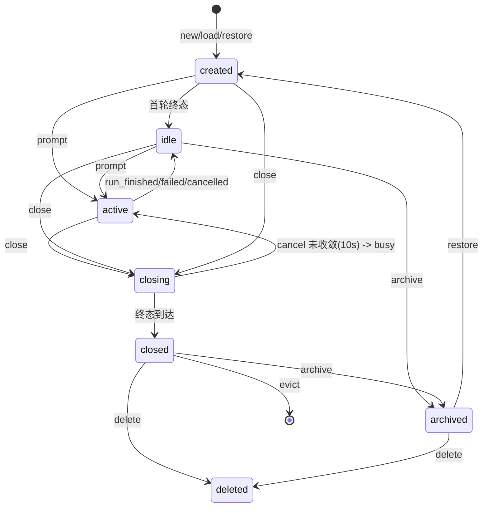

# 会话生命周期状态机设计（0dk S1：所有权、关闭、删除与私有扩展）

> 状态：`current-design`（2026-10-21，331 批；0dk S1）。**S2 已落码（332 批，见 [`332 档`](audits/332_SESSION_LIFECYCLE_IMPLEMENTATION_2026-10-21.md)）；实现偏差登记在该档 §4（会话级事件用持久标记而非 run journal、close 不归档）。**
> 设计权威：[`ADR-0010`](../adr/ADR-0010-fusion-runtime-and-agent-architecture.md)；用户裁决（2026-10-21）：**Web 为唯一交互面，TUI 冻结**；**close 走私有扩展**；**扩展层与传输解耦，保持底座可更换**。
> 上游：318 审查 P0-4（[`318 档`](audits/318_FULL_PROJECT_REVIEW_PHASE1_2026-10-19.md)）／319 已落部分／329 保活（[`329 档`](audits/329_FIVE_ISSUE_FIX_REWIND_KEEPALIVE_CDP_SWEEP_AND_0DM_S2_2026-10-21.md)）／330 契约基线 S2/S3（[`330 档`](audits/330_SURFACE_CONTRACT_BASELINE_2026-10-21.md)）。
> 本稿只定**会话边界**，不改 loop、工具面、上下文、写控语义。

---

## §1 问题与决策

### 1.1 现状四问题（318/329 证据）

| # | 问题 | 证据 |
|---|---|---|
| 1 | 无单一 owner：`session/new`、`session/load`、桥 spawn、CLI 维护命令各自改会话状态 | `acp_server.rs` sessions map；`acp_pump.rs` 槽；`main.rs` 维护分派 |
| 2 | 无 close：协议 0.10.4 无此方法，web 关页面只断 WS，会话对象留在 map | `acp_server.rs:4931` 注释 |
| 3 | `sessions` 无界：只增不减，长跑进程内存单调涨 | 318 §3 P2 |
| 4 | 删除会复活：删除后下一条 prompt 重新物化侧车 | 318 §3 P2、0dk 验收⑦ |

### 1.2 三条裁决

1. **Web 唯一交互面**：TUI 标 `frozen`（维护只修崩溃/安全，不再加交互面，不删代码）；`orz -p` 与 `--stdio` 保留为无头/集成入口。
2. **close 走私有扩展**：`_orz/session_close`，不动 vendored `xai-acp-lib`，不追 ACP v1；语义对齐 v1（先 cancel 再释放），线格式不追。
3. **扩展层与传输解耦**：orz 自定义 `SessionCommand` 面；ACP 只是适配器。换底座时重写适配器，不重写会话逻辑。

### 1.3 非目标

跨进程恢复（会话随进程死）、多写者并发、ACP v1 升级、TUI 可写恢复。

---

## §2 角色与所有权

| 角色 | 持有 | 不持有 |
|---|---|---|
| **agent process**（owner） | 会话内存态、`.gsa/sessions/<s8>.lease` OS 锁、run 表、补充队列、terminal backend | — |
| **bridge**（`orz-web`，transport host） | 每 workspace 一个 child 槽、8 MiB backlog、attach 元信息 | 会话真相（不解析 messages/plan） |
| **client**（Web） | 视图状态（items/marker/输入框） | 会话真相；只发命令、渲染事件 |
| **CLI 维护命令** | 一次性动作 | 长期会话状态 |

**所有权规则**：会话 owner 唯一＝持有 lease 的进程；bridge 的 attach 只决定“谁在收帧”，不改变 owner。

---

## §3 状态机

### 3.1 状态

| 状态 | 含义 | 持久化 | 可观测面（334 修复后） |
|---|---|---|---|
| `created` | 已持 lease、无在途 run；侧车在首个成功 prompt 后才落（`new` 不写侧车） | 内存＋lease | `_orz/session_state` 查询（attach 时也发一次当前态通知） |
| `idle` | 上一轮已终态 | 侧车 | 查询；终态转移通知 |
| `active` | 有 run 在途 | 侧车＋journal | 查询；通知；`run_evidence` |
| `closing` | 已发 cancel，等终态 | 内存 | **334**：收尾窗口内查询可读 `closing`，并发 `closing` 通知 |
| `closed` | 已释放 lease、移出内存；侧车保留 | 侧车＋`.closed` 标记 | 查询（`already=true`）；通知 |
| `archived` | 已打包 `.gsa/archives/*.gz`，活区侧车移除 | 包 | **334**：`is_archived` 派生（包在、活区无侧车），可查询、可删除 |
| `deleted` | 侧车/包/run 目录已删，留 tombstone | tombstone | 查询；通知 |

### 3.2 转移表

| 动词 | 允许的源状态 | 结果 | 失败码 |
|---|---|---|---|
| `new` | —（或 `closed` 的新 id） | `created` | — |
| `load` | `closed` / 归档包 | `created`（回放后） | `session_not_found` |
| `attach` | `created/idle/active` | 状态不变（绑客户端） | `attach_conflict`（桥 409） |
| `prompt` | `idle` | `active` | `session_busy`（已有 run）/ `session_not_found`（closed/deleted） |
| 终态事件 | `active` | `idle` | — |
| `cancel` | `active` | `active`→`idle`（`cancelled` 终态） | — |
| `close` | `created/idle/active` | `closing`→`closed` | `session_busy`（cancel 未收敛）/ `lease_conflict` |
| `archive` | `idle/closed` | `archived` | `session_busy`（有 run）/ `invalid_state` |
| `restore` | `archived` | `created` | `session_not_found` |
| `delete` | `closed/archived`；实现另允许 `created/idle`（先 close 再删） | `deleted` | `session_busy`（`active/closing`）/ `lease_conflict` |
| `evict` | `idle` | `closed`（reason=evict） | 不适用于 `active` |

**动词表口径**：本表共 **十一行**（`new/load/attach/prompt/终态事件/cancel/close/archive/restore/delete/evict`），是状态机的完整动词面。索引/TODO/BACKLOG 旧称「六动词」只是历史简写——若按核心生命周期取六个，可读作 `new/load/prompt/close/delete/archive`（`restore` 为 `archive` 的逆、`attach` 是传输绑定、`cancel/evict/终态事件` 是转移条件）；**不另立第二套状态机，以本表十一行为准**。

**delete 的便捷分支（有意偏差，已写入设计）**：实现允许 `created/idle` 先 `close` 再删（省去用户先手动关闭的一步）；`active/closing` 一律拒绝（`session_busy`，不半删）；`closed/archived` 直接删。§4 不变量 4 与 §7 已按此口径同步。

**公开态的可观测面（334 修复后）**：七态全部保留，且都有查询面——`created/idle/active` 由内存行＋run 事实派生；`closed/deleted` 由 `.closed`/`.deleted` 持久标记；`closing` 在收尾窗口内可查询并收到通知（334 把「置位＋通知」与「移出表」拆开，不再同一临界区完成）；`archived` 由「归档包存在且活区无侧车」派生（`is_archived`），因此可查询、也可按 archived 直接删除。

### 3.3 图



---

## §4 不变量

1. **唯一 owner**：一个 `<s8>` 同一时刻只有一个进程持 lease；第二进程 `lease_conflict`（fail-closed）。
2. **单飞 prompt**：`active` 时再 `prompt` 返回 `session_busy`；排队走 `_orz/queue_append`。
3. **close 先 cancel**：`close` 必须先取消在途 run 并等到终态，才释放 lease。
4. **删除前置**：`delete` 默认只允许 `closed/archived`；实现另允许 `created/idle` 先 `close` 再删（便捷分支，见 §3.2）；`active/closing` 一律拒（`session_busy`）。
5. **不隐式物化**：`prompt` 只查表，不重建；缺失即 `session_not_found`（删除不复活）。
6. **幂等**：`close` 对 `closed` 返回 `already=true`；`delete` 对 `deleted` 同。
7. **有界**：内存会话表上限 32（可配），`active` 不驱逐，`idle` 按 LRU 驱逐并走 `close(evict)`。
8. **状态可观测**：每次转移发 `_orz/session_state` 通知；journal 记 `session_closed`/`session_deleted`。
9. **侧车是真相**：内存态可由侧车重建（新进程 `load`）；runtime 态（队列/后台/审批）不重建。
10. **attach 不回放**：附着只绑帧，不重放历史；历史由 `session/load` 或 `/api/conversations` 提供。

---

## §5 命令面（私有扩展）

### 5.1 传输无关的命令枚举（orz 自有类型）

```rust
// orz/crates/orz-host/src/session_ops.rs（新模块）
pub enum SessionCommand {
    Close { session_id: String, reason: CloseReason },
    State { session_id: String },
}

pub enum CloseReason { UserClose, Switch, Evict, Shutdown }

pub struct SessionOutcome {
    pub session_id: String,
    pub state: SessionState,
    pub closed: bool,
    pub already: bool,
}
```

- `session_ops` 不依赖 ACP 类型、不依赖 `xai-acp-lib`；只依赖 `SessionStore` trait（查/删/取消/释放）。
- ACP 适配器（`acp_server.rs` 内薄层）负责 `_orz/session_close` ↔ `SessionCommand::Close`。

### 5.2 线格式

```json
// 请求
{"jsonrpc":"2.0","id":7,"method":"_orz/session_close",
 "params":{"sessionId":"<uuid>","reason":"switch"}}

// 成功
{"jsonrpc":"2.0","id":7,"result":{"sessionId":"<uuid>","state":"closed",
 "closed":true,"already":false}}

// 失败
{"jsonrpc":"2.0","id":7,"error":{"code":-32011,"message":"session busy",
 "data":{"code":"session_busy","class":"session",
         "hint":"等待当前回复结束后重试","evidence":"RUN-<s8>-3"}}}
```

### 5.3 错误码（orz 扩展段）

| code | 名称 | 触发 |
|---|---|---|
| -32010 | `session_not_found` | 未知/已删/tombstone |
| -32011 | `session_busy` | 有在途 run 且 cancel 未收敛 |
| -32012 | `invalid_state` | 状态不允许该动词（如 active→archive） |
| -32013 | `lease_conflict` | 另一进程持 lease |
| -32014 | `attach_conflict` | 桥层第二客户端（HTTP 409 对应） |

---

## §6 close 序列

1. 校验 `sessionId` 存在且本进程持 lease（否则 `lease_conflict`）。
2. 若 `active`：调用 `cancel_current_run`，等待终态，上限 **10s**。
3. 10s 未收敛：返回 `session_busy`，状态保持 `active`（不半关闭）；客户端可重试或强杀（强杀不在本设计）。
4. 释放 lease（drop 锁文件句柄）。
5. 移出 `sessions` 表；清 runtime 态（队列/审批/terminal backend）。
6. 写 journal `session_closed{reason, run_id?}`。
7. 返回 `{closed:true, already:false}`；重复调用返回 `already:true`。

**不用 force kill 的理由**：强杀会留下未配对 tool 与孤儿后台；宁可让客户端看到 busy 并重试。

---

## §7 删除不复活

- `prompt` 路径只做 `sessions.get(id)`；**删除物化分支**（这是 318 的根因）。
- `delete`：先置 `deleted` 并从表移除，再删侧车/归档/run 目录；写 `.gsa/sessions/<s8>.deleted` tombstone。
- 运行中删除：`active/closing` → `session_busy`（不半删；实现统一回 `session_busy`，不另用 `invalid_state`）；`created/idle` 先 close 再删，`closed/archived` 直接删（见 §3.2）。
- CLI `delete-session` 走同一 `SessionCommand::Delete` 原语（先 close，再删）；跨进程持 lease 时 `lease_conflict`。

---

## §8 有界与驱逐

- 上限 32（`ORZ_SESSION_CAP`，0＝不限）；超出时按 `last_prompt_at` 驱逐最旧 `idle`。
- 被驱逐会话走 `close(Evict)`：侧车保留，可再 `load`；发 `_orz/session_state{state:"closed",reason:"evict"}`。
- bridge 槽不设上限（一 workspace 一槽），child 退出由 reaper 回收。

---

## §9 失败文案（四要素）

### 9.1 六类

| class | 例子 | 是否上浮到用户 |
|---|---|---|
| `connection` | 桥不可达、令牌失效、占用 | 是 |
| `session` | 不存在/忙/已删/被占 | 是 |
| `permission` | 拒绝、超时 | 是 |
| `provider` | 模型/网络/额度 | 是 |
| `tool` | 工具失败 | **否**（留在对话里，模型自处理） |
| `internal` | 未知 | 是（带 run id） |

### 9.2 四要素

每条上浮错误＝「发生了什么＋为什么（分类）＋下一步＋证据在哪」。

| 现状 | 目标 |
|---|---|
| `无法连接桥（令牌无效或已有活动会话）` | 「连不上本地桥：可能令牌过期，或另一个窗口正占用。→ 刷新页面；仍失败请关掉其他窗口。」 |
| `撤回失败：${e.message}` | 「撤回没成功：会话正被另一个操作占用。→ 等当前回复结束后重试。」 |
| `[错误] ${error}` | 「模型请求失败（额度/网络）。→ 检查余额后重试；记录：RUN-…」 |
| `交付状态读取失败：…` | 「读取失败：会话已切换。→ 重新打开交付状态。」（保留现有“只读投影”限定） |

### 9.3 落点

- 宿主：`error.data = {code, class, hint, evidence}`（evidence＝run id / 文件路径）。
- Web：`copy.js` 一张表（code→四要素），未知 code 走 `internal` 兜底；smoke 断言关键词。
- 只上浮用户可动作的错误；工具失败不改现有呈现。

---

## §10 与 329 保活、ACP、TUI 的关系

| 面 | 关系 |
|---|---|
| 329 保活 | attach 是传输层（WS↔child）；close 是会话层。grace 到期 → bridge 杀 child → 进程死 → lease 由 OS 释放，会话隐式 closed（无事件）；侧车可 `load` |
| ACP | 保持 0.10.4 现状；`_orz/*` 为 orz 扩展；外部客户端收到 `method_not_found`，互不影响 |
| TUI | `frozen`：不加 close 入口，`never resumes` 不变；其 ACP 审批路径保留 |
| 跨进程 | 不恢复队列/后台/审批（0dk 余项，本设计明确不做） |

---

## §11 底座可迁移性

- 会话逻辑（状态机、close、驱逐、错误码）住在 `orz-host` 自有模块，不 import `xai-acp-lib`。
- 传输适配器只做三件事：方法名映射、参数反序列化、错误码映射；预计 <300 行。
- `_orz/*` 前缀、schema、错误段（-32010..-32014）均为 orz 自有资产，换底座时随 orz 走。
- 若未来升级 ACP v1：新增适配器把 `session/close` 映射到同一 `SessionCommand::Close`，不改状态机。

---

## §12 验收

### S2 单测（实现批）

1. `close_idle_releases_lease_and_removes_entry`
2. `close_active_cancels_then_closes`
3. `close_times_out_returns_busy_and_keeps_active`
4. `close_is_idempotent`
5. `prompt_after_delete_returns_not_found_without_materializing`
6. `delete_active_is_rejected`
7. `sessions_cap_evicts_lru_idle_only`
8. `second_process_gets_lease_conflict`
9. `session_state_notification_emitted_on_transition`
10. `unknown_private_method_returns_method_not_found`

### S4 真机（0dn S2 场景）

刷新重连、关闭会话后再载入、删除后不复活、保活过期提示、第二标签占用提示——五条先跑。

### 读数

- 内存会话数在 100 轮开关后 ≤32；
- close 在 idle 下 <100ms、active 下 ≤10s 或明确 busy；
- 删除后 `prompt` 100% `session_not_found`（无侧车重建）。

---

## §13 边界与不做

- 不做跨进程恢复、多写者、force kill、ACP v1 升级、TUI 可写恢复。
- 不改 `0di` 撤回语义（recall 仍 idle-only，与 close 互斥由 `closing` 状态保证）。
- 不改写控/审批语义（审批超时仍 300s fail-closed）。
